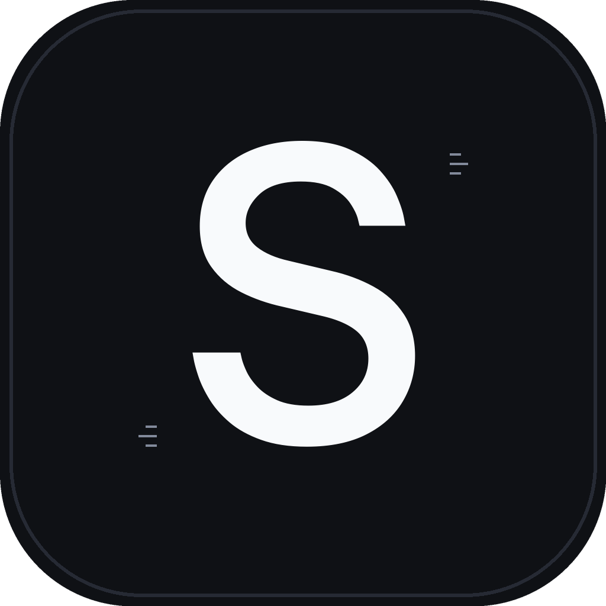

<p align="center">
  
</p>

<h1 align="center">Spekr</h1>

<p align="center">
  <strong>A fast, modern acoustic spectrum analyser written in Rust.</strong><br>
  Cross-platform standalone tool for macOS, Linux, and Windows.
</p>

<p align="center">
  <a href="https://github.com/hanngoc1406/spekr/actions/workflows/ci.yml"></a>
  <a href="https://github.com/hanngoc1406/spekr/releases"></a>
  <a href="LICENSE"></a>
  <a href="https://www.rust-lang.org"></a>
</p>

<p align="center">
  <a href="#overview">Overview</a> &bull;
  <a href="#features">Features</a> &bull;
  <a href="#technology-stack">Tech Stack</a> &bull;
  <a href="#installation">Installation</a> &bull;
  <a href="#usage">Usage</a> &bull;
  <a href="#architecture">Architecture</a> &bull;
  <a href="#license-and-legal-notice">License</a> &bull;
  <a href="README.vi.md">Tiếng Việt</a>
</p>

---

## Overview

Spekr is an open-source acoustic spectrum analyser designed to help audio engineers, producers, archivists, and audiophiles visually inspect audio files and verify their acoustic integrity.

Originally inspired by the classic **Spek** utility created by Alexander Kojevnikov, Spekr is built from the ground up in pure, memory-safe Rust. It delivers instant multi-threaded FFT processing, high-DPI GPU-accelerated rendering, an integrated media player with instant A/B switching, and a comprehensive headless command-line interface.

## Features

- Comprehensive Audio Format Support: Decodes MP3, FLAC, WAV, AAC, M4A, ALAC, OGG Vorbis, Opus, AIFF, and uncompressed PCM via pure Rust decoders without requiring external FFmpeg shared libraries.
- High-Performance Multi-Threaded FFT: Powered by RustFFT and Rayon, utilizing SIMD optimizations (AVX2, FMA, NEON) across all available CPU cores.
- Interactive Spectrogram Canvas:
  - Real-time Zoom and Pan: Smooth mouse-wheel zooming across frequency (kHz) and time (mm:ss) axes; drag to pan.
  - Real-Time Inspector HUD: Hover crosshairs display instantaneous timestamp, exact frequency in Hz, and amplitude in decibels (dB).
  - Dynamic Color Palettes: Switch instantly between SoX (default), Classic, Magma, Viridis, Inferno, Turbo, and Monochrome without recomputing FFT matrices.
- Integrated Media Player:
  - Full-width seek bar with sample-accurate navigation.
  - Digital LCD playback counter and embedded album art extraction.
  - Instant A/B Comparison: Seamlessly toggle between two audio tracks at the identical timestamp to compare lossless sources against lossy transcodes.
- Batch Processing and Playlist Navigation:
  - Open directories or drag-and-drop multiple audio files.
  - Playlist sidebar for rapid track switching.
  - Multi-threaded batch export of high-resolution spectrogram PNGs.
- Universal Typography Support: Embedded Be Vietnam Pro font with automated Unicode NFC normalization and system CJK fallback, ensuring flawless rendering across macOS, Linux, and Windows.
- Headless Command-Line Interface: Scriptable image generation for automated quality control pipelines and server environments.

## Technology Stack

| Component | Implementation | Characteristics |
| :--- | :--- | :--- |
| Audio Decoding | Symphonia | 100% pure Rust decoders, zero external C library dependencies |
| FFT Processing | RustFFT + Rayon | Multi-threaded parallel STFT pipeline with SIMD acceleration |
| User Interface | eframe / egui | Hardware-accelerated GPU rendering at 60 FPS, Retina/HiDPI ready |
| Audio Engine | Rodio | Real-time audio playback sink with sample-accurate seek |
| Typography | ab_glyph + Be Vietnam Pro | Embedded typography with automated Unicode NFC normalization |
| CLI Engine | Clap | Headless scriptable image generation for automated workflows |
| Distribution | Standalone binary | Self-contained executable with zero runtime dependencies |

## Installation

### Pre-Compiled Binaries (Direct Download)

Direct download links for the latest stable release:

| Operating System | Architecture | Direct Download |
| :--- | :--- | :--- |
| **macOS** | Universal (Apple Silicon & Intel) | [**Spekr-macos.dmg**](https://github.com/hanngoc1406/spekr/releases/latest/download/Spekr-macos.dmg) |
| **Windows** | x86_64 (64-bit) | [**Spekr-windows-x86_64.zip**](https://github.com/hanngoc1406/spekr/releases/latest/download/Spekr-windows-x86_64.zip) (Portable) |
| **Windows** | x86_64 (64-bit) | [**Spekr-windows-x86_64.exe**](https://github.com/hanngoc1406/spekr/releases/latest/download/Spekr-windows-x86_64.exe) |
| **Linux** | x86_64 (glibc 2.31+) | [**Spekr-linux-x86_64.tar.gz**](https://github.com/hanngoc1406/spekr/releases/latest/download/Spekr-linux-x86_64.tar.gz) |

Command-line archives for terminal users are also available: [**spekr-macos-arm64.tar.gz**](https://github.com/hanngoc1406/spekr/releases/latest/download/spekr-macos-arm64.tar.gz) (Apple Silicon) and [**spekr-macos-x86_64.tar.gz**](https://github.com/hanngoc1406/spekr/releases/latest/download/spekr-macos-x86_64.tar.gz) (Intel). All releases and historical versions can be viewed on the [Releases](https://github.com/hanngoc1406/spekr/releases) page.

### Building from Source

Prerequisites: A working [Rust toolchain](https://rustup.rs/) (Rust 1.85 or newer).

```bash
# Clone the repository
git clone https://github.com/hanngoc1406/spekr.git
cd spekr

# Build optimized release binary
cargo build --release

# The compiled binary will be located at:
# target/release/spekr (Unix) or target/release/spekr.exe (Windows)
```

On Linux systems, ensure development headers for ALSA are installed prior to compilation:
```bash
# Debian / Ubuntu
sudo apt-get install -y libasound2-dev libgl1-mesa-dev

# Fedora / RHEL
sudo dnf install -y alsa-lib-devel mesa-libGL-devel

# Arch Linux
sudo pacman -S alsa-lib
```

## Usage

### Graphical User Interface (GUI)

Launch without arguments to open an empty window, or pass an audio file or directory path directly:

```bash
# Launch application
spekr

# Open a specific audio file directly
spekr recording.flac

# Open an entire album folder
spekr /path/to/album/
```

#### Keyboard Shortcuts

- `Space`: Toggle audio playback / pause.
- `Concert Scroll Wheel`: Zoom spectrogram in/out at cursor position.
- `Left Click + Drag`: Pan spectrogram canvas when zoomed.
- `Double Click`: Reset zoom to full overview.

### Command-Line Interface (Headless CLI)

Spekr supports scriptable headless execution without initializing a display server:

```bash
# Basic export
spekr input.flac -o spectrogram.png

# High-resolution export with specific palette and FFT window
spekr input.flac -o output.png --width 1920 --height 1080 --fft 4096 --palette viridis --window blackman-harris

# Inspect a single channel with customized dynamic range
spekr track.wav -o left_channel.png --channel 1 --palette sox --min-db -100.0 --max-db 0.0

# Batch export an entire directory
spekr /path/to/audio/folder -o /path/to/output/folder
```

#### CLI Reference

```text
Usage: spekr [OPTIONS] [AUDIO_FILE]

Arguments:
  [AUDIO_FILE]  Path to input audio file or directory

Options:
  -o, --output <PATH>      Destination path for generated PNG file or directory
      --width <INT>        Image width in pixels [default: 1200]
      --height <INT>       Image height in pixels [default: 600]
      --fft <INT>          FFT window size: 1024, 2048, 4096, 8192 [default: 2048]
      --window <WINDOW>    Window function: hann, hamming, blackman-harris, flattop, rect [default: hann]
      --palette <PALETTE>  Color palette: sox, classic, magma, viridis, inferno, turbo, mono [default: sox]
      --min-db <FLOAT>     Lower amplitude limit in decibels [default: -120.0]
      --max-db <FLOAT>     Upper amplitude limit in decibels [default: 0.0]
      --channel <CHANNEL>  Audio channel selection: mix, 1 (left), 2 (right) [default: mix]
  -h, --help               Print help information
  -V, --version            Print version information
```

## Architecture

The project is structured into modular components:

- `src/audio.rs`: Audio decoding, metadata parsing, and album art extraction using `symphonia`.
- `src/fft.rs`: Window functions and Fast Fourier Transform computation using `rustfft`.
- `src/pipeline.rs`: Multi-threaded parallel STFT column pipeline using `rayon`.
- `src/render.rs`: Offscreen spectrogram image rendering, anti-aliased axes, labels, and colorbars.
- `src/playback.rs`: Audio sink and playback stream management using `rodio`.
- `src/palette.rs`: Color space interpolations and perceptually uniform colormaps.
- `src/fonts.rs`: Typography subsystem, embedded TrueType fonts, and Unicode NFC normalizer.
- `src/batch.rs`: Directory scanner and parallel batch export scheduler.
- `src/app.rs`: State machine and graphical user interface built with `eframe` and `egui`.
- `src/cli.rs`: Command-line interface definitions and argument parsing using `clap`.

## Contributing

Contributions are welcome. Please adhere to the following workflow:

1. Fork the repository and create your feature branch (`git checkout -b feature/improvement`).
2. Verify code quality and pass all automated tests:
   ```bash
   cargo fmt --check
   cargo clippy -- -D warnings
   cargo test
   ```
3. Commit your changes (`git commit -m 'Implement feature'`).
4. Push to the branch (`git push origin feature/improvement`) and open a Pull Request.

## License and Legal Notice

### License

This project is licensed under the [GNU General Public License v3.0 (GPL-3.0)](LICENSE).

### Attribution and Disclaimer

Spekr is an independent open-source project written in Rust. It was inspired by the classic **Spek** software originally created by **Alexander Kojevnikov** ([spek.cc](http://spek.cc)). 

Spekr is not affiliated with, maintained by, or endorsed by the original Spek project or its author. All trademarks and project names remain the property of their respective owners.
